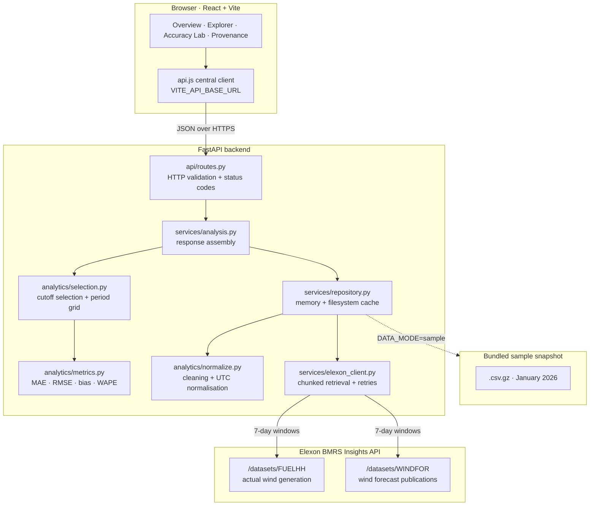
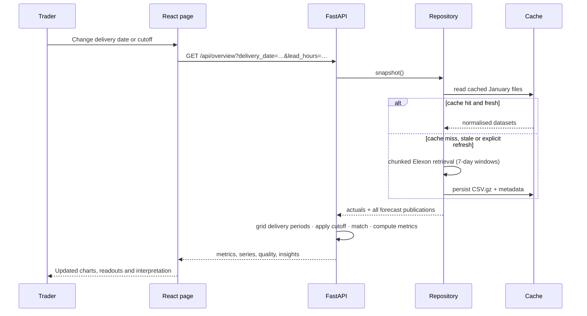

# AERON — Wind Forecast Intelligence

A trading-terminal grade analytics application for evaluating the **national wind generation forecast that was actually available at a purchasing decision**, against **realised wind generation**, for the Elexon BMRS January 2026 analysis period.

The product answers one question precisely:

> At the moment our trading desk had to decide, what did the national wind forecast say, what actually happened, and how wrong was the forecast we could have seen?

AERON deliberately does **not** use the latest available forecast for a historical period. It reconstructs the information set available at a configurable decision cutoff, using Elexon `publishTime` timestamps.

---

## Table of contents

1. [Business use case](#1-business-use-case)
2. [What the application does](#2-what-the-application-does)
3. [Technology stack](#3-technology-stack)
4. [Architecture](#4-architecture)
5. [Data sources](#5-data-sources)
6. [Historical forecast-selection logic](#6-historical-forecast-selection-logic)
7. [Metric definitions](#7-metric-definitions)
8. [Data-quality handling](#8-data-quality-handling)
9. [Directory and file guide](#9-directory-and-file-guide)
10. [Prerequisites](#10-prerequisites)
11. [Run it locally in VS Code](#11-run-it-locally-in-vs-code)
12. [Run the automated tests](#12-run-the-automated-tests)
13. [Run with Docker Compose](#13-run-with-docker-compose)
14. [Environment variables](#14-environment-variables)
15. [Free deployment](#15-free-deployment)
16. [Verification record](#16-verification-record)
17. [Known limitations](#17-known-limitations)
18. [Design decisions](#18-design-decisions)

---

## 1. Business use case

A UK electricity utility buys electricity in the day-ahead wholesale market. Wind is the largest single source of variability in the GB generation mix, so the accuracy of the national wind forecast at the point of purchase materially changes exposure.

The trading team needs to:

- see the wind forecast **as it stood at their decision time**, not the cleaned-up forecast published hours later;
- quantify how reliable that forecast has been, in MW, across a full month of half-hourly settlement periods;
- understand whether errors are biased in one direction (systematic over- or under-forecasting) or merely noisy;
- see which delivery periods are hardest to forecast;
- verify the provenance of every number used in the analysis.

### Scope boundary

> Wind generation shortfall is **not** the utility's total procurement requirement. Consumer demand, other generation sources and wholesale prices are outside the scope of this analysis. AERON measures forecast accuracy for national wind generation only. This statement is repeated in the application interface.

---

## 2. What the application does

### Overview dashboard

- Delivery-date selector over 1–31 January 2026, plus a full-month range mode.
- Configurable decision cutoff: rolling lead time (`C = T − lead_hours`) or one fixed decision instant.
- Dataset status and API connection indicator in the top bar.
- Forecast-versus-actual generation chart, with an optional retrospective error envelope.
- Summary accuracy metrics: MAE, RMSE, bias, WAPE, matched period count, overforecast percentage.
- Largest absolute forecast error with its publication time and realised lead time.
- Analytical interpretations generated from the selected records (never hardcoded).

### Forecast Explorer

- Per-delivery-period table: selected publication, forecast, actual, signed error, absolute error, realised lead time.
- Missing forecasts and missing actuals are retained and labelled, never silently dropped.
- Server-side filtering by observation status, error direction and delivery timestamp.
- Client-side sorting on every numeric column, keyboard-navigable rows, detail drawer for the selected period.
- CSV export of exactly the selected records, with download confirmation feedback.

### Accuracy Lab

- MAE, RMSE, bias, WAPE, over/underforecast counts, mean actual and forecast levels.
- Error by delivery period and absolute-error distribution.
- Comparison of several decision cutoffs **on the identical set of common delivery periods**, with native and common observation counts disclosed separately.
- Verdict text that refuses to declare a winner when the difference is not material.
- Explicit metric formulas and the error sign convention.

### Data Provenance

- Elexon dataset endpoints, parameters and fields actually used.
- Retrieval timestamp, retrieval duration and per-chunk record counts.
- Raw versus used record counts, matched observations, missing actual/forecast counts.
- Duplicates and invalid records removed, non-`WIND` rows dropped, negative values flagged.
- Latest relevant forecast publication timestamp, distinct publication count.
- Cache status, backend, TTL and age.
- Data-quality warnings, retrieval failures and known limitations.

### Cross-cutting interface behaviour

- Custom AERON branding and icon system; obsidian/graphite surfaces with chartreuse accents.
- Loading skeletons, empty states, structured error messages with retry, CSV export toasts.
- Tooltips on every metric definition.
- Full keyboard navigation with visible focus rings; `prefers-reduced-motion` respected.
- Working "reset filters" actions.
- Responsive layout down to a 414 px viewport with no horizontal overflow.

---

## 3. Technology stack

| Layer | Choice | Version |
| --- | --- | --- |
| Frontend framework | React | 18.3.1 |
| Build tool | Vite | 6.0.7 |
| Styling | Tailwind CSS (design tokens in CSS variables) | 3.4.17 |
| Charts | Recharts | 2.15.0 |
| Icons | Lucide React | 0.468.0 |
| Routing | React Router | 6.28.0 |
| Backend framework | FastAPI | 0.115.6 |
| ASGI server | Uvicorn | 0.34.0 |
| Data processing | Pandas / NumPy | 2.2.3 / 2.2.1 |
| HTTP client | HTTPX | 0.28.1 |
| Validation / settings | Pydantic / pydantic-settings | 2.10.4 / 2.7.0 |
| Tests | Pytest | 8.3.4 |
| Containers | Docker, Docker Compose | any current release |

No LLM API, paid API, paid database or third-party service is required. The only external dependency at runtime is the public Elexon BMRS Insights API.

---

## 4. Architecture



### Request flow for a dashboard interaction



---

## 5. Data sources

Both datasets are read from the official **Elexon BMRS Insights API** (`https://data.elexon.co.uk/bmrs/api/v1`). Documentation was inspected before implementation and the contract below reflects the live API, not assumptions.

### Actual wind generation — FUELHH

- Documentation: <https://bmrs.elexon.co.uk/api-documentation/endpoint/datasets/FUELHH>
- Endpoint used: `GET /datasets/FUELHH`
- Parameters used: `settlementDateFrom`, `settlementDateTo`, `fuelType=WIND`
- Fields consumed: `startTime`, `publishTime`, `settlementDate`, `settlementPeriod`, `fuelType`, `generation`
- Granularity: **half-hourly**, average MW over each settlement period.
- The application filters to `fuelType = WIND`.

### Forecast wind generation — WINDFOR

- Documentation: <https://bmrs.elexon.co.uk/api-documentation/endpoint/datasets/WINDFOR>
- Endpoint used: `GET /datasets/WINDFOR`
- Parameters used: `publishDateTimeFrom`, `publishDateTimeTo`
- Fields consumed: `startTime`, `publishTime`, `generation`
- Granularity: **hourly delivery targets**, published on an **irregular 2–4 hour cycle**.

### Verified API characteristics that shaped the implementation

| Characteristic | Verified behaviour | Consequence in AERON |
| --- | --- | --- |
| Range limit | Both endpoints reject any request whose date range exceeds **7 days** (`400`, "must not exceed 7 days") | Retrieval is chunked into ≤7-day windows; the chunk plan is displayed on the Provenance page |
| `stream` endpoints | `/FUELHH/stream` and `/WINDFOR/stream` return only the most recent ~24 hours and ignore date parameters | Historical retrieval uses the dataset endpoints, not the stream endpoints |
| Parameter names | The documented query parameters are `settlementDateFrom/To` and `publishDateTimeFrom/To` | No undocumented parameters are sent; requests are shown verbatim in the UI |
| Forecast granularity | WINDFOR `startTime` values fall on the hour (00 minutes), FUELHH on :00 and :30 | Each half-hour uses the forecast published for the hour containing it; this is disclosed in the UI |
| Publication cadence | 280 distinct publication timestamps in January, spaced 2–4 hours apart, always at :25/:30 | Realised lead time varies per delivery period and is reported, not assumed constant |
| Forecast depth | Each publication carries 73 hourly values, roughly 46–67 hours ahead | Long lead cutoffs can lose delivery periods; observation counts are always disclosed |
| Environment date | The API is live and served January 2026 records as historical data | January 2026 is treated strictly as **history**, never as a live forecast |

### Sample-data mode

A bundled snapshot of the **same January 2026 records** lives in `backend/app/data/sample/` (127 KB gzipped CSV). It is only read when `DATA_MODE=sample`. In that mode the interface displays a persistent `SAMPLE DATA` chip in the status bar and an explicit warning in the quality panel. The live Elexon integration remains fully implemented and is the default.

---

## 6. Historical forecast-selection logic

This is the analytical core of the assignment.

### The rule

For every delivery period `T` and the applicable decision cutoff `C`:

1. Consider only WINDFOR records whose delivery period corresponds to `T`.
2. Discard every record whose `publishTime` is **after** `C`.
3. Select the record with the **latest** `publishTime` among those remaining.

A publication exactly at the cutoff is eligible (`publishTime <= C`). A publication one second after the cutoff is not.

The application never selects "the latest forecast currently available" for a historical period. That later publication is deliberately discarded.

### Two cutoff modes

| Mode | Cutoff used for period `T` | Typical use |
| --- | --- | --- |
| **Rolling lead** (default) | `C = T − lead_hours` (4, 8, 12, 24, 36 or 48 h) | A desk that always transacts a fixed number of hours ahead |
| **Fixed instant** | One absolute instant, applied to every period | A single day-ahead gate-closure style decision |

> The cutoff is an **analytical convention for evaluating forecast skill**. It is not an official market deadline, and the interface states this wherever the cutoff is described.

### Why the realised lead time is not exactly the requested lead time

WINDFOR publishes every 2–4 hours. With a requested 12-hour cutoff, the latest eligible publication is typically issued 12.0–15.5 hours before delivery. AERON reports the **realised** lead time per period (median, minimum and maximum) rather than pretending a fixed horizon exists.

### Implementation workflow

1. **Build the delivery-period grid in local time.** For each London delivery day the grid runs from local midnight to the next local midnight in 30-minute steps. This is computed from `Europe/London` midnight boundaries converted to UTC, so it does **not** assume 48 records per day.
2. **Parse timestamps.** All timestamps are parsed to timezone-aware instants and normalised to UTC for comparison.
3. **Expand forecast publications.** WINDFOR hourly delivery targets are mapped onto the half-hourly grid by flooring the delivery period to its containing hour; every candidate publication for that hour is retained.
4. **Filter by cutoff.** Only candidates with `publishTime <= C` survive.
5. **Select the latest eligible publication** per delivery period.
6. **Retrieve and filter actuals** to `fuelType = WIND`.
7. **Match on the delivery timestamp** (UTC instant equality).
8. **Retain unmatched periods** with an explicit status: `missing_forecast`, `missing_actual` or `missing_both`, plus a machine-readable reason (`published_after_cutoff` or `no_publication_in_window`).
9. **Compute metrics only from `matched` rows.**
10. **Return records and metadata** to the frontend.

### Daylight saving

Because the period grid is generated from local midnight boundaries, a spring-forward London day produces **46** periods and an autumn-back day produces **50**. This is covered by automated tests. The January analysis window contains no DST transition, but the logic is correct for any window.

Timestamps are stored and compared in UTC and **displayed in `Europe/London`**.

---

## 7. Metric definitions

### Error sign convention

```
error = forecast_generation − actual_generation        (MW)
```

- **Positive** error → the forecast was **higher** than actual generation → **overforecast**.
- **Negative** error → the forecast was **lower** than actual generation → **underforecast**.

### Metrics

With `eᵢ = fᵢ − aᵢ` for every **matched** delivery period `i`, and `n` matched observations:

| Metric | Formula | Unit | Notes |
| --- | --- | --- | --- |
| **MAE** | `mean(|eᵢ|)` | MW | Direction-agnostic average miss |
| **RMSE** | `sqrt(mean(eᵢ²))` | MW | Penalises large misses |
| **Bias** | `mean(eᵢ)` | MW | Positive = systematic overforecast |
| **WAPE** | `Σ|eᵢ| / Σaᵢ × 100` | % | Undefined when `Σaᵢ = 0`; returned as `null`, never as zero or infinity |
| **Matched periods** | count of `matched` rows | count | The `n` used by every metric above |
| **Overforecast %** | `count(eᵢ > 0) / n × 100` | % | Share of matched periods running high |

Supporting statistics: absolute-error p50/p90, signed-error p05/p95, largest absolute error, mean actual, mean forecast, over/under/exact counts, coverage percentage.

### Unit discipline

Every generation value is an **average MW over its delivery period**, exactly as Elexon publishes it. AERON labels the unit as `MW` throughout and never presents it as `MWh`.

### Comparison discipline

When cutoffs are compared, the metrics are recomputed on the **intersection** of delivery periods that are matched under *every* selected cutoff. Both the native observation count (per cutoff) and the common observation count are shown. A verdict is only stated as "lowest MAE" on that common sample; if the difference is below 2%, the interface explicitly states that **no cutoff is claimed to be more accurate**.

---

## 8. Data-quality handling

| Situation | Handling |
| --- | --- |
| Missing actual generation | Retained as `missing_actual`; excluded from metrics. **Never treated as zero.** |
| Missing forecast | Retained with reason `published_after_cutoff` or `no_publication_in_window`; excluded from metrics |
| Duplicate actual records | De-duplicated on delivery timestamp (last record kept); count reported on Provenance |
| Duplicate forecast records | De-duplicated on `(publishTime, startTime)`; count reported on Provenance |
| Non-`WIND` rows | Dropped after filtering; count reported |
| Non-numeric or null `generation` | Row dropped, counted as an invalid record, never coerced to zero |
| Malformed timestamps | Row dropped, counted; parsing errors surfaced as warnings |
| Negative generation | Retained (Elexon can publish them) and explicitly flagged as a warning |
| Empty selection | Metrics return `null`, the interface shows an empty state with an explanation |
| Partial retrieval | A failed chunk is recorded, the remaining chunks are used, and the limitation is displayed in the Provenance failures panel and the quality warnings |
| Backend unavailable | The interface shows a structured error with the backend message and a working retry button; navigation stays usable |
| Unexpected response envelope | Rejected as a validation error rather than silently parsed |

---

## 9. Directory and file guide

```
aeron/
├── backend/
│   ├── app/
│   │   ├── api/
│   │   │   ├── dependencies.py        Repository and settings dependency providers
│   │   │   └── routes.py              All HTTP routes, query validation and CSV response
│   │   ├── analytics/
│   │   │   ├── metrics.py             MAE, RMSE, bias, WAPE, distributions, common-sample intersection
│   │   │   ├── normalize.py           Schema validation, fuel filter, UTC normalisation, de-duplication
│   │   │   └── selection.py           London period grid, cutoff application, latest-eligible selection
│   │   ├── config/
│   │   │   ├── constants.py           Dataset names, endpoints, statuses, scope note
│   │   │   └── settings.py            Pydantic settings loaded from environment / .env
│   │   ├── data/sample/
│   │   │   ├── fuelhh_wind_2026_01.csv.gz    Bundled Elexon actual wind snapshot (1,488 rows)
│   │   │   └── windfor_2026_01.csv.gz        Bundled Elexon WINDFOR snapshot (22,776 rows)
│   │   ├── schemas/models.py          Pydantic response models for every endpoint
│   │   ├── services/
│   │   │   ├── analysis.py            Assembles API responses, insights and verdict text
│   │   │   ├── csv_export.py          CSV column contract and number formatting
│   │   │   ├── elexon_client.py       Chunked retrieval, bounded retries, schema checks
│   │   │   └── repository.py          Memory + filesystem cache, provenance metadata
│   │   ├── utils/timezones.py         UTC/London conversion and grid helpers
│   │   └── main.py                    FastAPI app, CORS, exception handlers, logging
│   ├── scripts/build_sample_data.py   Regenerates the bundled sample snapshot from Elexon
│   ├── tests/
│   │   ├── conftest.py                Fixtures and test environment
│   │   ├── test_metrics.py            18 metric, zero-denominator and edge-case tests
│   │   ├── test_normalize.py          11 cleaning, duplicate and invalid-value tests
│   │   ├── test_selection.py          14 cutoff, matching, grid and DST tests
│   │   ├── test_elexon_client.py      10 chunking, retry and validation tests
│   │   └── test_api.py                18 endpoint, schema and error-contract tests
│   ├── Dockerfile                     Python 3.12 slim, non-root runtime
│   ├── requirements.txt               Pinned dependencies
│   ├── pytest.ini                     Test configuration
│   └── .env.example                   Backend environment template
├── frontend/
│   ├── src/
│   │   ├── components/
│   │   │   ├── brand/BrandMark.jsx            Custom AERON mark and wordmark
│   │   │   ├── charts/                        Forecast, error, histogram and cutoff charts + tooltips
│   │   │   ├── controls/WorkspaceControls.jsx Delivery date, range, cutoff and reset controls
│   │   │   ├── layout/                        Nav rail, top bar and app shell
│   │   │   ├── panels/                        Publication detail drawer, cutoff comparison
│   │   │   ├── tables/RecordsTable.jsx        Sortable, keyboard-navigable records table
│   │   │   └── ui/                            Panel, readouts, tooltips, states, toasts, error boundary
│   │   ├── config/navigation.js       Page metadata and navigation model
│   │   ├── hooks/                     Analysis parameter state, dataset state, data fetching hook
│   │   ├── pages/                     Overview, Explorer, Accuracy Lab, Provenance, 404
│   │   ├── services/api.js            Central API client reading VITE_API_BASE_URL
│   │   ├── styles/index.css           Design tokens, layout primitives and component styles
│   │   ├── utils/                     Number, date and timezone formatting helpers
│   │   ├── App.jsx                    Router and provider composition
│   │   └── main.jsx                   React entry point
│   ├── scripts/check-imports.mjs      Verifies every relative import resolves
│   ├── public/favicon.svg             AERON favicon
│   ├── Dockerfile                     Multi-stage Node build + nginx runtime
│   ├── nginx.conf                     SPA fallback, gzip and asset caching
│   ├── vite.config.js                 Dev/preview proxy, code-split production build
│   ├── tailwind.config.js             Tailwind bound to the design tokens
│   ├── postcss.config.js              PostCSS pipeline
│   ├── vercel.json                    Vercel build settings and SPA rewrites
│   └── .env.example                   Frontend environment template
├── docker-compose.yml                 Backend + frontend with health-gated startup
├── render.yaml                        Render blueprint for the backend
├── .env.example                       Compose-level overrides
├── .gitignore
├── README.md
└── DEPLOYMENT.md
```

---

## 10. Prerequisites

| Tool | Minimum version | Check |
| --- | --- | --- |
| Python | 3.11 (3.12 recommended) | `python --version` |
| Node.js | 20 LTS | `node --version` |
| npm | 10 | `npm --version` |
| Git | 2.30 | `git --version` |
| Docker Desktop | current | `docker --version` (only for the Docker path) |

All commands below are written for **Windows PowerShell**, run from the folder you extract the archive into.

---

## 11. Run it locally in VS Code

### Extract and open

```powershell
Expand-Archive -Path AERON_Wind_Forecast_Intelligence.zip -DestinationPath C:\Projects
cd C:\Projects\AERON_Wind_Forecast_Intelligence
code .
```

In VS Code install the recommended extensions when prompted (Python, Docker, Tailwind CSS IntelliSense).

### Terminal 1 — backend

```powershell
cd backend
python -m venv .venv
.\.venv\Scripts\Activate.ps1
python -m pip install --upgrade pip
pip install -r requirements.txt
copy .env.example .env
python -m uvicorn app.main:app --reload --port 8000
```

If PowerShell blocks the activation script, run once:

```powershell
Set-ExecutionPolicy -Scope Process -ExecutionPolicy Bypass
```

Confirm the backend is alive:

- <http://localhost:8000/health>
- <http://localhost:8000/docs> (interactive OpenAPI documentation)
- <http://localhost:8000/api/overview?delivery_date=2026-01-15&lead_hours=12>

The first request downloads January 2026 from Elexon in five FUELHH chunks and six WINDFOR chunks (roughly 3 seconds), then persists the result to `backend\.cache\aeron\`. Later requests are served from that cache until the TTL expires or you press **Refresh**.

### Terminal 2 — frontend

```powershell
cd frontend
npm install
copy .env.example .env
npm run dev
```

Open <http://localhost:5173>.

> `.env.example` sets `VITE_API_BASE_URL=http://localhost:8000`, so the browser calls the backend directly. The Vite dev server also proxies `/api` and `/health` to the backend, which is why leaving `VITE_API_BASE_URL` empty also works locally.

### Offline / no-network demonstration

```powershell
cd backend
$env:DATA_MODE="sample"
python -m uvicorn app.main:app --reload --port 8000
```

The interface shows a `SAMPLE DATA` chip. The bundled snapshot contains the same January 2026 Elexon records, so every metric is identical, but nothing is fetched live.

---

## 12. Run the automated tests

### Backend suite (71 tests)

```powershell
cd backend
.\.venv\Scripts\Activate.ps1
python -m pytest
```

Verbose per-test output:

```powershell
python -m pytest -v
```

Run a single module:

```powershell
python -m pytest tests/test_selection.py -v
```

The API tests run in `DATA_MODE=sample` against the bundled snapshot, so they need no network access and are deterministic.

### Frontend production build

```powershell
cd frontend
npm run build
npm run lint:imports
npm run preview
```

`npm run build` must complete without errors; `npm run lint:imports` verifies that every relative import resolves to a real module.

### Regenerating the sample snapshot

```powershell
cd backend
.\.venv\Scripts\Activate.ps1
python scripts\build_sample_data.py
```

---

## 13. Run with Docker Compose

### Start

```powershell
cd C:\Projects\AERON_Wind_Forecast_Intelligence
copy .env.example .env
docker compose up --build
```

- Frontend: <http://localhost:8080>
- Backend health: <http://localhost:8000/health>

The frontend image bakes `VITE_API_BASE_URL` in at build time, because Vite inlines environment variables. To point the containerised frontend at a different backend:

```powershell
$env:VITE_API_BASE_URL="https://your-backend.example.com"
docker compose up --build
```

### Useful commands

```powershell
docker compose up -d --build          # rebuild and run detached
docker compose ps                     # container health
docker compose logs -f backend        # follow backend logs
docker compose logs --tail 100        # last 100 lines of every service
docker compose exec backend python -m pytest   # run tests inside the image
docker compose down                   # stop and remove containers
docker compose down -v                # stop and also drop volumes
docker compose build --no-cache       # force a clean rebuild
docker compose config                 # validate the compose file
```

If a container exits immediately:

```powershell
docker compose logs backend
docker compose run --rm backend python -c "import app.main; print('import ok')"
```

The backend waits for its `/health` check before the frontend container starts, so the first page load never races a cold API.

---

## 14. Environment variables

### Backend (`backend/.env`)

| Variable | Default | Purpose |
| --- | --- | --- |
| `DATA_MODE` | `live` | `live` fetches Elexon; `sample` uses the bundled snapshot |
| `ELEXON_BASE_URL` | `https://data.elexon.co.uk/bmrs/api/v1` | API root |
| `ELEXON_TIMEOUT_SECONDS` | `30` | Per-request HTTP timeout |
| `ELEXON_MAX_RETRIES` | `3` | Attempts for transient errors (429, 5xx, timeouts) |
| `ELEXON_RETRY_BACKOFF_SECONDS` | `1.5` | Base for exponential backoff, capped at 8 s |
| `ELEXON_MAX_CHUNK_DAYS` | `7` | Maximum window per request; the Elexon API rejects anything larger |
| `ANALYSIS_START_DATE` | `2026-01-01` | Analysis window start |
| `ANALYSIS_END_DATE` | `2026-01-31` | Analysis window end |
| `FORECAST_PUBLISH_LOOKBACK_DAYS` | `7` | Extra publication history retrieved before the window |
| `FORECAST_PUBLISH_LOOKAHEAD_DAYS` | `2` | Extra publication history retrieved after the window |
| `DEFAULT_LEAD_HOURS` | `12` | Default rolling cutoff |
| `ALLOWED_LEAD_HOURS` | `4,8,12,24,36,48` | Cutoffs offered in the interface |
| `CACHE_ENABLED` | `true` | Enable the filesystem cache |
| `CACHE_DIR` | `/tmp/aeron-cache` | Cache location; ephemeral filesystems are fine |
| `CACHE_TTL_HOURS` | `24` | Cache freshness window |
| `CORS_ORIGINS` | local dev origins | Comma-separated exact allowed origins |
| `CORS_ORIGIN_REGEX` | `https://([a-z0-9-]+\.)*vercel\.app` | Regex for Vercel preview deployments |
| `LOG_LEVEL` | `INFO` | Uvicorn / app log level |

### Frontend (`frontend/.env`)

| Variable | Default | Purpose |
| --- | --- | --- |
| `VITE_API_BASE_URL` | *(empty)* | Backend base URL. Empty means same-origin, which the Vite proxy and Docker setup handle |
| `VITE_PROXY_TARGET` | `http://127.0.0.1:8000` | Dev/preview proxy target only |

> Every `VITE_*` variable is **public** — it is inlined into the browser bundle. Never put a secret here. AERON needs no frontend secrets.

### Secrets

There are no secrets in this project. No API keys, tokens or credentials are required by Elexon's public API, and none are present in the repository, the Docker images or the environment templates.

---

## 15. Free deployment

Full step-by-step instructions, including GitHub publication, are in **[DEPLOYMENT.md](./DEPLOYMENT.md)**.

Summary:

| Component | Platform | Free-tier note |
| --- | --- | --- |
| Frontend | Vercel (Hobby) | Free for personal, non-commercial projects; SPA rewrite configured in `vercel.json` |
| Backend | Render (Free web service) | 512 MB RAM, 0.1 CPU; **spins down after 15 minutes of inactivity** and takes about a minute to wake; ephemeral filesystem (handled by the cache design); 750 instance hours per workspace per month |

Deployment URL placeholders — replace these with your own; **no public deployment has been performed by me**:

```
Frontend: https://<your-vercel-project>.vercel.app
Backend:  https://<your-render-service>.onrender.com
Health:   https://<your-render-service>.onrender.com/health
```

---

## 16. Verification record

Everything below was executed in the development environment. Nothing in this section is projected or assumed.

### Verified

- **Elexon integration**: live retrieval of January 2026 returned 1,488 FUELHH `WIND` records and 22,776 WINDFOR records, matching the raw API payloads inspected independently with `curl`.
- **Forecast selection**: for delivery period `2026-01-15T00:00Z` with a 12-hour cutoff, the API independently confirmed the selected publication is `2026-01-14T11:30Z` (15,813 MW) — the latest publication at or before the cutoff, not the later ones in the dataset.
- **Cutoff exclusion**: delivery periods whose only publications postdate the cutoff are labelled `missing_forecast` / `published_after_cutoff` rather than silently borrowing a later forecast.
- **Backend test suite**: `71 passed` (`pytest`, 4.3 s).
- **Frontend production build**: `vite build` succeeds (2230 modules, code-split into app/react/charts bundles).
- **Import integrity**: `check-imports.mjs` confirms all 33 relative imports resolve.
- **Browser verification**: all four pages rendered in headless Chromium against the live backend with **zero console errors and zero page errors**.
- **Interaction checks**: full-month range, fixed-cutoff mode, cutoff-mode and reset-filters controls, status/direction filters, column sorting, row selection drawer, CSV download (`aeron_wind_2026-01-15_lead12h_live.csv`), and the export confirmation toast all worked.
- **Resilience check**: with `/api/overview` deliberately aborted, the interface showed a structured error, a working retry button, and remained navigable.
- **Accessibility checks**: keyboard tab order reaches the brand, all four navigation items, refresh, date selector and range toggle with visible focus rings.
- **Responsive checks**: 414 px viewport, zero horizontal overflow on all four pages.
- **Cache behaviour**: a warm restart served the chunk plan and record counts from disk without re-downloading.
- **Sample mode**: produced metrics identical to live mode with the sample-data warning displayed.

### Not verified in this environment

- **Docker build and `docker compose up`** — Docker is **not installed** in this execution environment. The Dockerfiles, `docker-compose.yml`, nginx configuration and health checks are complete and internally consistent, but the image build and container run are **unverified**. Run `docker compose up --build` locally to confirm.
- **Vercel and Render deployment** — no hosting accounts were accessed. Configuration is deployment-ready but no public URL has been created or tested.
- **Live browser testing on Windows** — the browser checks were run in headless Chromium on Linux; Windows rendering was not exercised.

---

## 17. Known limitations

1. **WINDFOR granularity.** Delivery targets are hourly while FUELHH actuals are half-hourly. Each half-hour is compared with the forecast for its containing hour. This is a property of the published data, not an analytical choice.
2. **Irregular publication cadence.** Cutoffs are honoured exactly, so the realised lead time varies between 2 and 4 hours around the requested value. Reported per period.
3. **Publication time ≠ model run time.** `publishTime` is when Elexon published the record, not when the underlying numerical model was initialised.
4. **Seven-day request ceiling.** Retrieval requires multiple chunks; a partial failure is reported rather than hidden, and a missing chunk reduces coverage.
5. **No intraday-updated actuals.** FUELHH has its own `publishTime`; AERON treats the latest retrieved value as the actual and does not attempt to reconstruct later settlement revisions.
6. **January 2026 only.** The deployment is scoped to the assignment window; dates outside it are rejected with a clear error.
7. **Analysis, not trading advice.** AERON measures forecast accuracy. It does not model procurement requirement, prices or imbalance exposure.
8. **Cold starts on free hosting.** A Render free instance wakes in about a minute; the interface surfaces a network error with retry if the first request times out.
9. **Filesystem cache on ephemeral hosts.** The cache is lost when a free instance restarts or spins down. This is by design: a cache miss re-downloads January 2026 in a few seconds.

---

## 18. Design decisions

| Decision | Rationale |
| --- | --- |
| Two cutoff modes (rolling lead and fixed instant) | A fixed lead time models a consistent trading process; a fixed instant models a single gate closure. Both are useful and neither is asserted to be the "official" deadline. |
| Rolling lead time as the default | It produces a full matched sample for any delivery date, which is the cleanest starting point for a demonstration. |
| Half-hourly grid built from London midnight | Correct DST behaviour without assuming 48 periods per day. |
| Metrics computed only from `matched` rows, with `null` rather than `0` | Prevents missing data from silently improving accuracy figures. |
| Common-sample comparison for cutoffs | Differences between cutoffs must not be an artefact of different sample composition. |
| Filesystem cache with TTL instead of a database | Zero cost, no credentials, compatible with ephemeral free-tier filesystems, and a miss costs only a few seconds. |
| Bundled sample snapshot in the repository | Guarantees a working demonstration with no network, while keeping the real integration as the default path. |
| Custom CSS design tokens over a component library | The brief called for a distinctive energy-trading identity; an off-the-shelf admin template would have produced a generic result. Tailwind is used for utility composition, with the visual system defined in `styles/index.css`. |
| Server-side filtering for the records table, client-side sorting | Filtering reduces payload; sorting up to 1,488 rows in the browser is instant and needs no extra round trip. |

---


## Data attribution

Contains public sector information made available by **Elexon Limited** under the terms of the **Elexon Open Data Licence**. Data source: Elexon BMRS Insights Solution — `FUELHH` and `WINDFOR` datasets. Elexon is not affiliated with, and does not endorse, this application.
